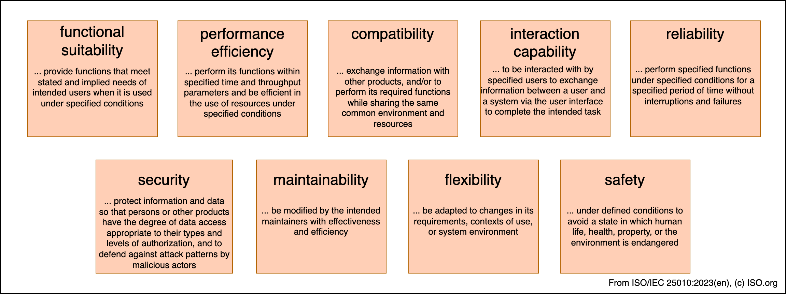

# Introduction and Goals
Expose self-hosted apps from your home network to the internet via an external gateway server (hosted on a VPS).

+ Expose anything from a basic HTTP(S) endpoint to a game severs using UDP
+ Fully transparent gateway server -> TLS connections only terminate at the agents
+ TLS connections only terminate at proxies
+ Easy configuration and deployment via Docker or Linux binary
+ Minimal resources required by relay server
+ Monitor service health
+ Build open source with self-hosting at heart

## Requirements Overview
### Functional
#### Must have
+ Proxy UDP connections
+ Proxy TCP connections
+ Proxy HTTP + HTTPS connections
+ TLS termination of HTTPS connections at proxy
+ Secure authentication of proxies to gateway
+ Verbose logging -> configurable
#### Should have
#### Could have

#### Won't have

### Non-Functional
#### Must have
+ Configuration via .toml config file
+ CLI interface
+ Usage documentation (Manpage for CLI
#### Should have
+ Offer pre-built GNU/Linux binaries
+ Offer docker images
+ Resilience to network interruptions
+ Low resource demand / high performance
+ High test coverage
#### Could have
+ Resilience to (D)DOS-Attacks

#### Won't have
+ No fancy UI
## Quality Goals

Contents

The top three (max five) quality goals for the architecture whose
fulfillment is of highest importance to the major stakeholders. We
really mean quality goals for the architecture. Don’t confuse them with
project goals. They are not necessarily identical.

Consider this overview of potential topics (based upon the [ISO
25010:2023](https://www.iso.org/obp/ui/#iso:std:iso-iec:25010:ed-2:v1:en)
standard):

<figure>

</figure>

For a more extensive (and open) collection of qualities, definitions and
example requirements, see the [Q42 quality
model](https://quality.arc42.org).

Motivation

You should know the quality goals of your most important stakeholders,
since they will influence fundamental architectural decisions. Make sure
to be very concrete about these qualities, avoid buzzwords. If you as an
architect do not know how the quality of your work will be judged…​

Form

A table with quality goals and concrete scenarios, ordered by priorities

## Stakeholders

Contents

Explicit overview of stakeholders of the system, i.e. all person, roles
or organizations that

- should know the architecture

- have to be convinced of the architecture

- have to work with the architecture or with code

- need the documentation of the architecture for their work

- have to come up with decisions about the system or its development

Motivation

You should know all parties involved in development of the system or
affected by the system. Otherwise, you may get nasty surprises later in
the development process. These stakeholders determine the extent and the
level of detail of your work and its results.

Form

Table with role names, person names, and their expectations with respect
to the architecture documentation (!). Do not repeat stakeholders'
functional and quality requirements. Identify their documentation needs
here.

Example

The following stakeholder roles recur across many projects. Use it as a
starting point, then adapt the roles, names and expectations to your
actual project. Not every project has all of these roles, and some will
have additional ones.

| Role/Name | Contact | Expectations |
|----|----|----|
| Product Owner | Product Management | Prioritizes features by business value; needs Section 1 (Requirements Overview, Quality Goals) kept aligned with product strategy |
| End Users / Customers | represented via UX research, support tickets | Need the system to be usable, reliable and fast; drive quality goals such as performance and usability |
| Software Architect(s) | Architecture Team | Own and maintain this documentation; use it to justify and communicate technical decisions |
| Development Team | Engineering Team | Need clear building blocks (Section 5) and runtime scenarios (Section 6) to implement correctly |
| Operations / SRE | Ops Team | Need the deployment view (Section 7) and cross-cutting concepts (Section 8, e.g. monitoring, logging) to run the system reliably |
| Security Officer / InfoSec | Security Team | Review the architecture against risks (Section 11) and quality requirements (Section 10); need evidence that security constraints are addressed |
| Compliance / Legal | Legal/Compliance Team | Need evidence that regulatory constraints (Section 2) are respected, e.g. data protection, licensing |
| Project Sponsor / Management | Steering Committee | Need confidence that architecture decisions (Section 9) support budget, timeline and strategic goals |

| Role/Name    | Contact         | Expectations        |
|--------------|-----------------|---------------------|
| *\<Role-1\>* | *\<Contact-1\>* | *\<Expectation-1\>* |
| *\<Role-2\>* | *\<Contact-2\>* | *\<Expectation-2\>* |
